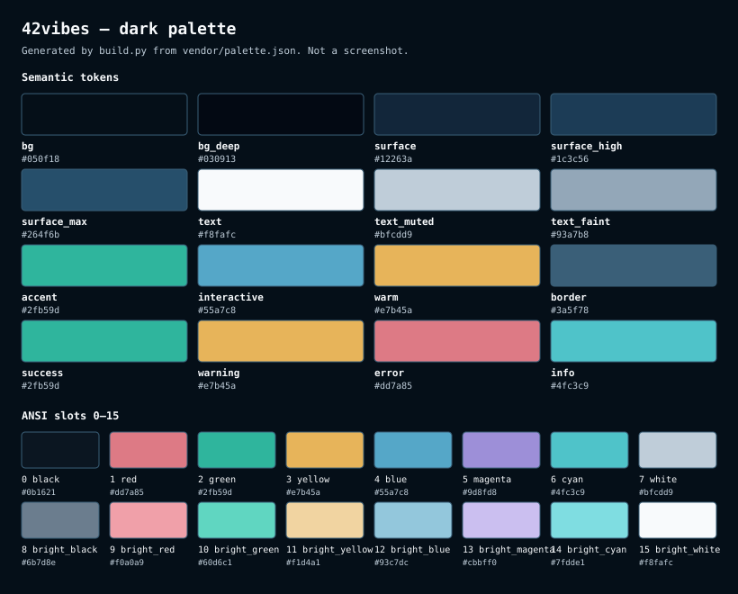
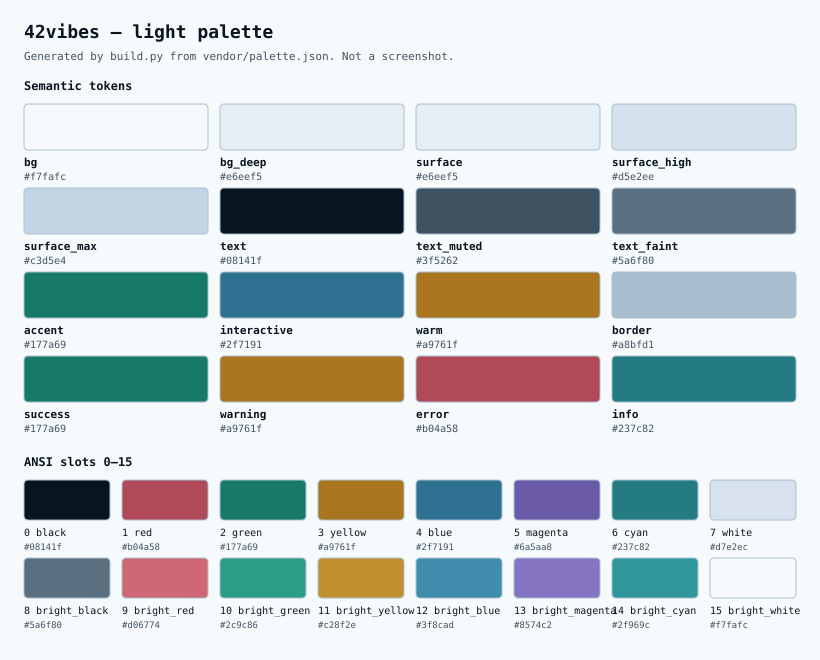

# 42vibes.vim

[English](README.md) · **Deutsch**

Ein eigenständiges Vim-Colorscheme aus der 42vibes-Farbwelt: tiefes Nachtblau,
Petrol als Akzent, gedecktes Blau als Sekundärfarbe, warmes Gold als Gegenpol.
Das Theme liefert Dark und Light aus einer Palette, ist für echtes Vim 8/9
geschrieben und läuft auch in Neovim (inkl. Treesitter-Gruppen).

`colors/42vibes.vim` ist **generiert**. Farben und Gruppen werden in
`build.py` gepflegt, nie in der Vim-Datei selbst.

## Farbpalette

Die semantischen Rollen stammen aus `vendor/palette.json` (Kopie von
`42vibes-palette/palette.json`):

| Rolle | Dark | Light |
| --- | --- | --- |
| Hintergrund | `#050f18` | `#f7fafc` |
| Tiefster Hintergrund | `#030913` | `#e6eef5` |
| Fläche | `#12263a` | `#e6eef5` |
| Fläche hervorgehoben | `#1c3c56` | `#d5e2ee` |
| Fläche maximal | `#264f6b` | `#c3d5e4` |
| Text | `#f8fafc` | `#08141f` |
| Text gedämpft | `#bfcdd9` | `#3f5262` |
| Text schwach | `#93a7b8` | `#5a6f80` |
| Akzent (Petrol) | `#2fb59d` | `#177a69` |
| Interaktiv (Blau) | `#55a7c8` | `#2f7191` |
| Warm (Gold) | `#e7b45a` | `#a9761f` |
| Rahmen | `#3a5f78` | `#a8bfd1` |
| Erfolg / Warnung / Fehler / Info | `#2fb59d` / `#e7b45a` / `#dd7a85` / `#4fc3c9` | `#177a69` / `#a9761f` / `#b04a58` / `#237c82` |

<!-- palette:start -->

### Palettenvorschau

Die folgenden Grafiken sind **generierte Vorschauen** aus
`vendor/palette.json` und keine Screenshots. `build.py` erzeugt sie als
reines SVG nach `preview/`.





Semantische Tokens (Dark/Light):

| Token | Dark | Light |
| --- | --- | --- |
| `bg` | `#050f18` | `#f7fafc` |
| `bg_deep` | `#030913` | `#e6eef5` |
| `surface` | `#12263a` | `#e6eef5` |
| `surface_high` | `#1c3c56` | `#d5e2ee` |
| `surface_max` | `#264f6b` | `#c3d5e4` |
| `text` | `#f8fafc` | `#08141f` |
| `text_muted` | `#bfcdd9` | `#3f5262` |
| `text_faint` | `#93a7b8` | `#5a6f80` |
| `accent` | `#2fb59d` | `#177a69` |
| `interactive` | `#55a7c8` | `#2f7191` |
| `warm` | `#e7b45a` | `#a9761f` |
| `border` | `#3a5f78` | `#a8bfd1` |
| `success` | `#2fb59d` | `#177a69` |
| `warning` | `#e7b45a` | `#a9761f` |
| `error` | `#dd7a85` | `#b04a58` |
| `info` | `#4fc3c9` | `#237c82` |

ANSI 0–15 (Dark/Light):

| Slot | Name | Dark | Light |
| ---: | --- | --- | --- |
| 0 | black | `#0b1621` | `#08141f` |
| 1 | red | `#dd7a85` | `#b04a58` |
| 2 | green | `#2fb59d` | `#177a69` |
| 3 | yellow | `#e7b45a` | `#a9761f` |
| 4 | blue | `#55a7c8` | `#2f7191` |
| 5 | magenta | `#9d8fd8` | `#6a5aa8` |
| 6 | cyan | `#4fc3c9` | `#237c82` |
| 7 | white | `#bfcdd9` | `#d7e2ec` |
| 8 | bright_black | `#6b7d8e` | `#5a6f80` |
| 9 | bright_red | `#f0a0a9` | `#d06774` |
| 10 | bright_green | `#60d6c1` | `#2c9c86` |
| 11 | bright_yellow | `#f1d4a1` | `#c28f2e` |
| 12 | bright_blue | `#93c7dc` | `#3f8cad` |
| 13 | bright_magenta | `#cbbff0` | `#8574c2` |
| 14 | bright_cyan | `#7fdde1` | `#2f969c` |
| 15 | bright_white | `#f8fafc` | `#f7fafc` |

<!-- palette:end -->

Dazu kommen acht Hue-Anker (`gray`, `red`, `orange`, `yellow`, `green`, `cyan`,
`blue`, `purple`), die zu je neun Stufen expandiert werden.

## Ramps

Jeder Hue-Anker wird in HSL zu einer Neuner-Rampe. Nur die Helligkeit wandert;
Farbton und Sättigung bleiben erhalten, damit Akzente kräftig bleiben statt
nach Weiß auszuwaschen. Die Sättigung wird ausschließlich bei den Stufen 100
und 900 mit `0.55` skaliert.

| Stufe | 100 | 200 | 300 | 400 | 500 | 600 | 700 | 800 | 900 |
| --- | --- | --- | --- | --- | --- | --- | --- | --- | --- |
| Dark: L-Offset | +0.28 | +0.16 | +0.09 | +0.04 | 0 | −0.10 | −0.20 | −0.30 | −0.38 |
| Light: L-Offset | −0.30 | −0.20 | −0.12 | −0.05 | 0 | +0.08 | +0.15 | +0.22 | +0.28 |

In Dark ist 100 die hellste und 900 die dunkelste Stufe; in Light ist es
umgekehrt. Dieselben Stufen tragen dadurch in beiden Modi dieselbe Bedeutung:
400 ist Vordergrund, 900 Flächen-/Diff-Hintergrund.

## Installation

### Linux und macOS (Vim)

```bash
mkdir -p ~/.vim/colors
cp colors/42vibes.vim ~/.vim/colors/
```

In der `~/.vimrc`:

```vim
set background=dark      " oder light
colorscheme 42vibes
```

Alternativ eine XDG-Ablage unter `~/.config/vim` (Vim lädt dieses Verzeichnis
nicht von allein, deshalb der `runtimepath`-Eintrag):

```bash
mkdir -p ~/.config/vim/colors
cp colors/42vibes.vim ~/.config/vim/colors/
```

```vim
set runtimepath^=~/.config/vim
set background=dark
colorscheme 42vibes
```

### Neovim

```bash
mkdir -p ~/.config/nvim/colors
cp colors/42vibes.vim ~/.config/nvim/colors/
```

```lua
-- init.lua
vim.opt.background = "dark" -- oder "light"
vim.cmd.colorscheme("42vibes")
```

### macOS Terminal.app

Terminal.app kann 256 Farben, aber kein 24-Bit-Truecolor. Ohne Truecolor nutzt
Vim automatisch die `ctermfg`/`ctermbg`-Werte, die dieses Theme für jede Farbe
mitliefert (siehe unten). Nichts weiter zu tun; `set notermguicolors` ist dort
der Normalfall. In iTerm2, Kitty, WezTerm oder Alacritty darf dagegen
`set termguicolors` aktiviert werden, dann greifen die `guifg`/`guibg`-Werte.

### Dark und Light

Das Theme setzt `background` nicht selbst. Es liest `&background` beim Laden
und wählt den passenden Block:

```vim
set background=dark
colorscheme 42vibes
```

Ein späteres `set background=light` lädt das Colorscheme über `g:colors_name`
automatisch neu. `hi clear` und ein durch `exists('syntax_on')` geschütztes
`syntax reset` stehen am Anfang, `g:colors_name` ist auf `42vibes` gesetzt.

## 256-Farben-Fallback

Für jede GUI-Farbe wird der nächste Nachbar unter den xterm-Indizes **16..255**
bestimmt: 6×6×6-Würfel (16–231) plus 24 Graustufen (232–255). Die Indizes 0–15
werden bewusst ausgelassen, weil Terminals sie unterschiedlich belegen. Der
Abstand wird in **OKLab** gemessen (euklidisch), also wahrnehmungsnah statt im
RGB-Würfel.

Die beiden dokumentierten Prüfpunkte:

| Farbe | Hex | nächster xterm-Index | Distanz (OKLab) |
| --- | --- | --- | --- |
| Dark Petrol / `accent` | `#2fb59d` | **36** (`#00af87`) | 0,0369 |
| Dark Blau / `interactive` | `#55a7c8` | **74** (`#5fafd7`) | 0,0306 |

Weitere wichtige Zuordnungen:

| Rolle | Dark | Light |
| --- | --- | --- |
| Normal | `#f8fafc` / 231 auf `#050f18` / 233 | `#08141f` / 233 auf `#f7fafc` / 231 |
| Comment | `#899cad` / 247 | `#55677a` / 60 |
| String | `#33c5ab` / 43 | `#136557` / 23 |
| Number | `#eabc6c` / 215 | `#93671b` / 94 |
| Function | `#64afcd` / 74 | `#29627e` / 24 |
| Keyword | `#aa9edd` / 146 | `#5f5098` / 61 |
| Type | `#5fc8ce` / 80 | `#237c82` / 30 |
| PreProc | `#e18a94` / 174 | `#9e424f` / 95 |
| Special | `#f2d69c` / 222 | `#735b0f` / 58 |
| Title | `#2fb59d` / 36 | `#177a69` / 29 |
| Directory | `#55a7c8` / 74 | `#2f7191` / 24 |

### Feste Overrides

Nur wo der nächste Nachbar kollidiert oder den Kontrast zerstört, weicht das
Theme mit einem festen Override ab. Die Tabelle ist vollständig:

| Modus | Farbe | Rolle | naiv | Override | Grund |
| --- | --- | --- | --- | --- | --- |
| dark | `#0c1715` | DiffAdd-Hintergrund | 233 | **22** | 233 ist auch Normal-Hintergrund, DiffAdd wäre unsichtbar |
| light | `#66baab` | DiffAdd-Hintergrund | 73 | **79** | nur 2,9:1 für den grünen Text, 79 erreicht 4,2:1 |
| light | `#8fb0c0` | DiffChange-Hintergrund | 109 | **110** | nur 2,9:1 für den blauen Text, 110 erreicht 3,1:1 |
| light | `#d2b7bb` | DiffDelete-Hintergrund | 181 | **224** | nur 2,3:1 für den roten Text, 224 erreicht 3,5:1 |
| light | `#a8bfd1` | Rahmen (VertSplit, PmenuThumb) | 250 | **109** | 250 ist mit 1,9:1 nahezu unsichtbar, 109 erreicht 2,4:1 |

Alle übrigen Farben verwenden unverändert den OKLab-Nachbarn.
`python3 build.py --report` gibt die komplette Zuordnung aus.

## Gruppen

**Basis-UI:** Normal, Comment, Constant, String, Character, Number, Boolean,
Float, Identifier, Function, Statement, Conditional, Repeat, Label, Operator,
Keyword, Exception, PreProc, Include, Define, Macro, PreCondit, Type,
StorageClass, Structure, Typedef, Special, SpecialChar, Tag, Delimiter,
SpecialComment, Debug, Underlined, Ignore, Error, Todo, ErrorMsg, WarningMsg,
ModeMsg, MoreMsg, Question, Title, Directory, MatchParen, Cursor, CursorLine,
CursorLineNr, LineNr, SignColumn, Visual, Search, IncSearch, StatusLine,
StatusLineNC, VertSplit, Pmenu, PmenuSel, PmenuSbar, PmenuThumb, TabLine,
TabLineSel, TabLineFill, DiffAdd, DiffChange, DiffDelete, DiffText, Folded,
NonText, EndOfBuffer, SpellBad, SpellCap, SpellRare, SpellLocal, QuickFixLine,
ColorColumn, WildMenu.

**Markdown:** markdownH1, markdownH2, markdownH3, markdownBold, markdownItalic,
markdownCode, markdownLinkText.

**Neovim** (nur innerhalb `if has('nvim')`, in beiden Hintergründen korrekt
gefärbt): @comment, @keyword, @function, @variable, @string, @number, @type,
@operator, @punctuation.delimiter, @markup.heading.1, @markup.heading.2,
@markup.heading.3, @markup.strong, DiagnosticError, DiagnosticWarn,
DiagnosticInfo, DiagnosticHint, DiagnosticOk.

## Fett

Bold wird sparsam und immer doppelt gesetzt (`gui=bold` **und** `cterm=bold`):

Title, ErrorMsg, WarningMsg, Todo, StatusLine, markdownH1, markdownH2,
markdownH3, markdownBold, @markup.heading.1, @markup.heading.2,
@markup.heading.3.

Keine Syntaxklasse ist pauschal fett. Kommentare und `SpecialComment` sind
kursiv, `Underlined` und `markdownLinkText` unterstrichen; `Spell*` nutzt
`undercurl` (im cterm: `underline`).

## Entwickeln

```bash
make build        # colors/42vibes.vim neu erzeugen
make validate     # Staleness, Struktur, Ramps, cterm-Mapping, Smoke-Test
make smoke        # nur der headless Vim-Lauf
make report       # cterm-Zuordnung ausgeben
make sync-palette # vendor/palette.json aus 42vibes-palette übernehmen
```

`build.py --check` schlägt fehl, wenn `colors/42vibes.vim` nicht zum Generator
passt; damit kann die eingecheckte Datei nicht unbemerkt von Hand geändert
werden. `validate.py` prüft unabhängig vom Generator:

- Struktur (`hi clear`, geschütztes `syntax reset`, `g:colors_name`, kein
  eigenmächtiges `set background`/`set termguicolors`),
- alle Pflichtgruppen in beiden Modi und den `has('nvim')`-Block,
- Bold exakt auf der erlaubten Liste, in gui und cterm,
- Rampen exakt nach den HSL-Regeln aus der Palette,
- cterm-Indizes im Bereich 16..255 und gleich dem OKLab-Nachbarn (außer den
  dokumentierten Overrides),
- Mindestkontraste der GUI- und cterm-Paare.

## Verifikation

Exakt ausgeführt (jeweils aus dem Repo):

```bash
vim -Nu NONE --cmd 'set rtp+=~/projects/42vibes-vim' \
  -c 'set background=dark' -c 'colorscheme 42vibes' -c 'hi Normal' -c 'qa!'
# -> Exit-Code 0, zeigt:
#    Normal ... ctermfg=231 ctermbg=233 guifg=#f8fafc guibg=#050f18

vim -Nu NONE --cmd 'set rtp+=~/projects/42vibes-vim' \
  -c 'set background=light' -c 'colorscheme 42vibes' -c 'hi Normal' -c 'qa!'
# -> Exit-Code 0, zeigt:
#    Normal ... ctermfg=233 ctermbg=231 guifg=#08141f guibg=#f7fafc

vim -Nu NONE -es -S test/smoke.vim
# -> Exit-Code 0, test/smoke.log:
#    dark: Normal gui=#f8fafc/#050f18 cterm=231/233, 83 Gruppen
#    light: Normal gui=#08141f/#f7fafc cterm=233/231, 83 Gruppen

python3 build.py --check   # -> Exit-Code 0
python3 validate.py        # -> Exit-Code 0
```

Neovim (falls installiert):

```bash
nvim --clean --headless -S test/smoke.vim
```

Der `has('nvim')`-Block ist so gebaut, dass dieselbe Liste in Neovim geprüft
wird; ohne installiertes `nvim` entfällt nur dieser zusätzliche Lauf.

Die Meldungen `Vim: Warning: Output is not to a terminal` bzw. `Input is not
from a terminal` entstehen, weil die Prüfkommandos ohne TTY laufen; sie sind
keine Theme-Fehler und ändern den Exit-Code nicht.

## Struktur

```text
.
├── build.py            # Generator: Ramps, OKLab-Fallback, Vimscript
├── validate.py         # unabhängige Struktur-/Farb-/Kontrastprüfung
├── Makefile            # build / validate / smoke / report / sync-palette
├── colors/
│   └── 42vibes.vim    # generiert, eingecheckt
├── test/
│   └── smoke.vim       # headless Test für dark und light
├── vendor/
│   └── palette.json    # Kopie von 42vibes-palette/palette.json
├── README.md           # Englisch
└── README.de.md        # Deutsch
```

## Hinweise

- Das Theme setzt weder `termguicolors` noch `background`; beides bleibt
  Sache der Konfiguration.
- Die Vim-Datei enthält keine `hi link`-Ketten, sondern explizite Werte für
  jede Gruppe; dadurch ist der cterm-Fallback überall garantiert.
- Treesitter-Gruppen werden nur in Neovim definiert. Echtes Vim 8/9 würde `@`-
  Gruppennamen nicht akzeptieren, deshalb der `has('nvim')`-Schutz.
- Die Palette ist vendored, damit das Repo für sich allein baubar ist.

## Lizenz

Dieses Repo steht unter der MIT-Lizenz. Siehe [`LICENSE`](LICENSE).

Copyright © 2026 42vibes
