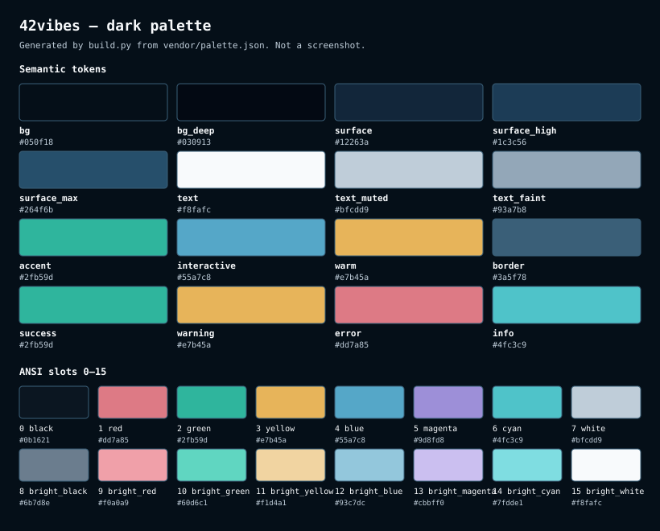
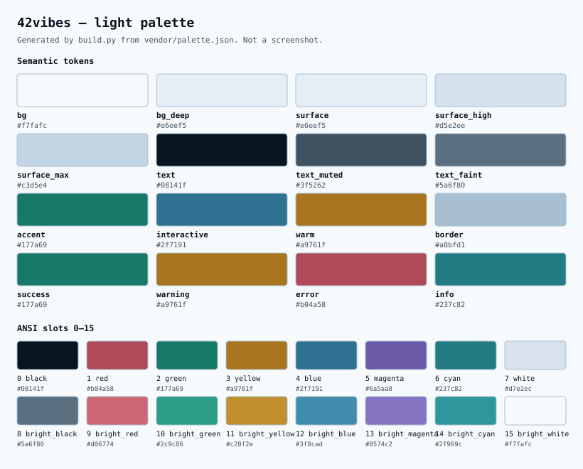

# 42vibes.vim

**English** · [Deutsch](README.de.md)

A standalone Vim color scheme from the 42vibes palette: deep night blue,
petrol as the accent, muted blue as the secondary color, warm gold as the
counterpoint. The theme ships dark and light from one palette, is written for
real Vim 8/9, and also runs in Neovim (including Treesitter groups).

`colors/42vibes.vim` is **generated**. Colors and groups are maintained in
`build.py`, never in the Vim file itself.

## Color palette

The semantic roles come from `vendor/palette.json` (copy of
`42vibes-palette/palette.json`):

| Role | Dark | Light |
| --- | --- | --- |
| Background | `#050f18` | `#f7fafc` |
| Deepest background | `#030913` | `#e6eef5` |
| Surface | `#12263a` | `#e6eef5` |
| Surface highlighted | `#1c3c56` | `#d5e2ee` |
| Surface maximum | `#264f6b` | `#c3d5e4` |
| Text | `#f8fafc` | `#08141f` |
| Text muted | `#bfcdd9` | `#3f5262` |
| Text faint | `#93a7b8` | `#5a6f80` |
| Accent (petrol) | `#2fb59d` | `#177a69` |
| Interactive (blue) | `#55a7c8` | `#2f7191` |
| Warm (gold) | `#e7b45a` | `#a9761f` |
| Border | `#3a5f78` | `#a8bfd1` |
| Success / Warning / Error / Info | `#2fb59d` / `#e7b45a` / `#dd7a85` / `#4fc3c9` | `#177a69` / `#a9761f` / `#b04a58` / `#237c82` |

<!-- palette:start -->

### Palette preview

The following graphics are **generated previews** from
`vendor/palette.json`, not screenshots. `build.py` writes them as pure
SVG to `preview/`.





Semantic tokens (Dark/Light):

| Token | Dark | Light |
| --- | --- | --- |
| `bg` | `#050f18` | `#f7fafc` |
| `bg_deep` | `#030913` | `#e6eef5` |
| `surface` | `#12263a` | `#e6eef5` |
| `surface_high` | `#1c3c56` | `#d5e2ee` |
| `surface_max` | `#264f6b` | `#c3d5e4` |
| `text` | `#f8fafc` | `#08141f` |
| `text_muted` | `#bfcdd9` | `#3f5262` |
| `text_faint` | `#93a7b8` | `#5a6f80` |
| `accent` | `#2fb59d` | `#177a69` |
| `interactive` | `#55a7c8` | `#2f7191` |
| `warm` | `#e7b45a` | `#a9761f` |
| `border` | `#3a5f78` | `#a8bfd1` |
| `success` | `#2fb59d` | `#177a69` |
| `warning` | `#e7b45a` | `#a9761f` |
| `error` | `#dd7a85` | `#b04a58` |
| `info` | `#4fc3c9` | `#237c82` |

ANSI 0–15 (Dark/Light):

| Slot | Name | Dark | Light |
| ---: | --- | --- | --- |
| 0 | black | `#0b1621` | `#08141f` |
| 1 | red | `#dd7a85` | `#b04a58` |
| 2 | green | `#2fb59d` | `#177a69` |
| 3 | yellow | `#e7b45a` | `#a9761f` |
| 4 | blue | `#55a7c8` | `#2f7191` |
| 5 | magenta | `#9d8fd8` | `#6a5aa8` |
| 6 | cyan | `#4fc3c9` | `#237c82` |
| 7 | white | `#bfcdd9` | `#d7e2ec` |
| 8 | bright_black | `#6b7d8e` | `#5a6f80` |
| 9 | bright_red | `#f0a0a9` | `#d06774` |
| 10 | bright_green | `#60d6c1` | `#2c9c86` |
| 11 | bright_yellow | `#f1d4a1` | `#c28f2e` |
| 12 | bright_blue | `#93c7dc` | `#3f8cad` |
| 13 | bright_magenta | `#cbbff0` | `#8574c2` |
| 14 | bright_cyan | `#7fdde1` | `#2f969c` |
| 15 | bright_white | `#f8fafc` | `#f7fafc` |

<!-- palette:end -->

In addition there are eight hue anchors (`gray`, `red`, `orange`, `yellow`,
`green`, `cyan`, `blue`, `purple`), each expanded into nine steps.

## Ramps

Each hue anchor is expanded in HSL into a nine-step ramp. Only lightness moves;
hue and saturation are preserved so accents stay strong instead of washing out
to white. Saturation is scaled by `0.55` only at steps 100 and 900.

| Step | 100 | 200 | 300 | 400 | 500 | 600 | 700 | 800 | 900 |
| --- | --- | --- | --- | --- | --- | --- | --- | --- | --- |
| Dark: L offset | +0.28 | +0.16 | +0.09 | +0.04 | 0 | −0.10 | −0.20 | −0.30 | −0.38 |
| Light: L offset | −0.30 | −0.20 | −0.12 | −0.05 | 0 | +0.08 | +0.15 | +0.22 | +0.28 |

In dark, 100 is the lightest and 900 the darkest step; in light it is the
reverse. The same steps therefore carry the same meaning in both modes: 400 is
foreground, 900 surface/diff background.

## Installation

### Linux and macOS (Vim)

```bash
mkdir -p ~/.vim/colors
cp colors/42vibes.vim ~/.vim/colors/
```

In `~/.vimrc`:

```vim
set background=dark      " or light
colorscheme 42vibes
```

Alternatively an XDG location under `~/.config/vim` (Vim does not load this
directory by itself, hence the `runtimepath` entry):

```bash
mkdir -p ~/.config/vim/colors
cp colors/42vibes.vim ~/.config/vim/colors/
```

```vim
set runtimepath^=~/.config/vim
set background=dark
colorscheme 42vibes
```

### Neovim

```bash
mkdir -p ~/.config/nvim/colors
cp colors/42vibes.vim ~/.config/nvim/colors/
```

```lua
-- init.lua
vim.opt.background = "dark" -- or "light"
vim.cmd.colorscheme("42vibes")
```

### macOS Terminal.app

Terminal.app supports 256 colors but no 24-bit truecolor. Without truecolor Vim
automatically uses the `ctermfg`/`ctermbg` values that this theme provides for
every color (see below). Nothing else to do; `set notermguicolors` is the
normal case there. In iTerm2, Kitty, WezTerm or Alacritty, however,
`set termguicolors` may be enabled, then the `guifg`/`guibg` values apply.

### Dark and light

The theme does not set `background` itself. It reads `&background` when loading
and picks the matching block:

```vim
set background=dark
colorscheme 42vibes
```

A later `set background=light` reloads the colorscheme automatically via
`g:colors_name`. `hi clear` and a `syntax reset` guarded by
`exists('syntax_on')` are at the beginning, `g:colors_name` is set to
`42vibes`.

## 256-color fallback

For every GUI color the nearest neighbor among xterm indices **16..255** is
determined: 6×6×6 cube (16–231) plus 24 greys (232–255). Indices 0–15 are
deliberately skipped because terminals assign them differently. Distance is
measured in **OKLab** (Euclidean), i.e. perceptually rather than in the RGB
cube.

The two documented check points:

| Color | Hex | nearest xterm index | Distance (OKLab) |
| --- | --- | --- | --- |
| Dark petrol / `accent` | `#2fb59d` | **36** (`#00af87`) | 0.0369 |
| Dark blue / `interactive` | `#55a7c8` | **74** (`#5fafd7`) | 0.0306 |

Further important mappings:

| Role | Dark | Light |
| --- | --- | --- |
| Normal | `#f8fafc` / 231 on `#050f18` / 233 | `#08141f` / 233 on `#f7fafc` / 231 |
| Comment | `#899cad` / 247 | `#55677a` / 60 |
| String | `#33c5ab` / 43 | `#136557` / 23 |
| Number | `#eabc6c` / 215 | `#93671b` / 94 |
| Function | `#64afcd` / 74 | `#29627e` / 24 |
| Keyword | `#aa9edd` / 146 | `#5f5098` / 61 |
| Type | `#5fc8ce` / 80 | `#237c82` / 30 |
| PreProc | `#e18a94` / 174 | `#9e424f` / 95 |
| Special | `#f2d69c` / 222 | `#735b0f` / 58 |
| Title | `#2fb59d` / 36 | `#177a69` / 29 |
| Directory | `#55a7c8` / 74 | `#2f7191` / 24 |

### Fixed overrides

Only where the nearest neighbor collides or destroys contrast does the theme
deviate with a fixed override. The table is complete:

| Mode | Color | Role | naive | Override | Reason |
| --- | --- | --- | --- | --- | --- |
| dark | `#0c1715` | DiffAdd background | 233 | **22** | 233 is also the Normal background, DiffAdd would be invisible |
| light | `#66baab` | DiffAdd background | 73 | **79** | only 2.9:1 for the green text, 79 reaches 4.2:1 |
| light | `#8fb0c0` | DiffChange background | 109 | **110** | only 2.9:1 for the blue text, 110 reaches 3.1:1 |
| light | `#d2b7bb` | DiffDelete background | 181 | **224** | only 2.3:1 for the red text, 224 reaches 3.5:1 |
| light | `#a8bfd1` | Border (VertSplit, PmenuThumb) | 250 | **109** | 250 is nearly invisible at 1.9:1, 109 reaches 2.4:1 |

All other colors use the OKLab neighbor unchanged.
`python3 build.py --report` prints the complete mapping.

## Groups

**Base UI:** Normal, Comment, Constant, String, Character, Number, Boolean,
Float, Identifier, Function, Statement, Conditional, Repeat, Label, Operator,
Keyword, Exception, PreProc, Include, Define, Macro, PreCondit, Type,
StorageClass, Structure, Typedef, Special, SpecialChar, Tag, Delimiter,
SpecialComment, Debug, Underlined, Ignore, Error, Todo, ErrorMsg, WarningMsg,
ModeMsg, MoreMsg, Question, Title, Directory, MatchParen, Cursor, CursorLine,
CursorLineNr, LineNr, SignColumn, Visual, Search, IncSearch, StatusLine,
StatusLineNC, VertSplit, Pmenu, PmenuSel, PmenuSbar, PmenuThumb, TabLine,
TabLineSel, TabLineFill, DiffAdd, DiffChange, DiffDelete, DiffText, Folded,
NonText, EndOfBuffer, SpellBad, SpellCap, SpellRare, SpellLocal, QuickFixLine,
ColorColumn, WildMenu.

**Markdown:** markdownH1, markdownH2, markdownH3, markdownBold, markdownItalic,
markdownCode, markdownLinkText.

**Neovim** (only inside `if has('nvim')`, correctly colored in both
backgrounds): @comment, @keyword, @function, @variable, @string, @number,
@type, @operator, @punctuation.delimiter, @markup.heading.1,
@markup.heading.2, @markup.heading.3, @markup.strong, DiagnosticError,
DiagnosticWarn, DiagnosticInfo, DiagnosticHint, DiagnosticOk.

## Bold

Bold is used sparingly and always set twice (`gui=bold` **and**
`cterm=bold`):

Title, ErrorMsg, WarningMsg, Todo, StatusLine, markdownH1, markdownH2,
markdownH3, markdownBold, @markup.heading.1, @markup.heading.2,
@markup.heading.3.

No syntax class is bold across the board. Comments and `SpecialComment` are
italic, `Underlined` and `markdownLinkText` underlined; `Spell*` uses
`undercurl` (in cterm: `underline`).

## Development

```bash
make build        # regenerate colors/42vibes.vim
make validate     # staleness, structure, ramps, cterm mapping, smoke test
make smoke        # only the headless Vim run
make report       # print the cterm mapping
make sync-palette # copy vendor/palette.json from 42vibes-palette
```

`build.py --check` fails if `colors/42vibes.vim` does not match the generator;
this prevents the checked-in file from being silently edited by hand.
`validate.py` checks independently of the generator:

- structure (`hi clear`, guarded `syntax reset`, `g:colors_name`, no
  self-authorized `set background`/`set termguicolors`),
- all required groups in both modes and the `has('nvim')` block,
- bold exactly on the allowed list, in gui and cterm,
- ramps exactly per the HSL rules from the palette,
- cterm indices in range 16..255 and equal to the OKLab neighbor (except for
  the documented overrides),
- minimum contrasts of the GUI and cterm pairs.

## Verification

Exactly executed (each from the repo):

```bash
vim -Nu NONE --cmd 'set rtp+=~/projects/42vibes-vim' \
  -c 'set background=dark' -c 'colorscheme 42vibes' -c 'hi Normal' -c 'qa!'
# -> exit code 0, shows:
#    Normal ... ctermfg=231 ctermbg=233 guifg=#f8fafc guibg=#050f18

vim -Nu NONE --cmd 'set rtp+=~/projects/42vibes-vim' \
  -c 'set background=light' -c 'colorscheme 42vibes' -c 'hi Normal' -c 'qa!'
# -> exit code 0, shows:
#    Normal ... ctermfg=233 ctermbg=231 guifg=#08141f guibg=#f7fafc

vim -Nu NONE -es -S test/smoke.vim
# -> exit code 0, test/smoke.log:
#    dark: Normal gui=#f8fafc/#050f18 cterm=231/233, 83 Gruppen
#    light: Normal gui=#08141f/#f7fafc cterm=233/231, 83 Gruppen

python3 build.py --check   # -> exit code 0
python3 validate.py        # -> exit code 0
```

Neovim (if installed):

```bash
nvim --clean --headless -S test/smoke.vim
```

The `has('nvim')` block is built so the same list is checked in Neovim;
without an installed `nvim`, only this additional run is skipped.

The messages `Vim: Warning: Output is not to a terminal` or `Input is not from
a terminal` occur because the check commands run without a TTY; they are not
theme errors and do not change the exit code.

## Structure

```text
.
├── build.py            # generator: ramps, OKLab fallback, Vimscript
├── validate.py         # independent structure/color/contrast checks
├── Makefile            # build / validate / smoke / report / sync-palette
├── colors/
│   └── 42vibes.vim    # generated, checked in
├── test/
│   └── smoke.vim       # headless test for dark and light
├── vendor/
│   └── palette.json    # copy of 42vibes-palette/palette.json
├── README.md           # English
└── README.de.md        # German
```

## Notes

- The theme sets neither `termguicolors` nor `background`; both remain the
  configuration's responsibility.
- The Vim file contains no `hi link` chains but explicit values for every
  group; this guarantees the cterm fallback everywhere.
- Treesitter groups are defined only in Neovim. Real Vim 8/9 would not accept
  `@` group names, hence the `has('nvim')` guard.
- The palette is vendored so the repo can be built on its own.

## License

This repository is licensed under the MIT License. See [`LICENSE`](LICENSE).

Copyright © 2026 42vibes
